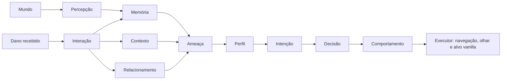

# 🐄 Mob Talk Mod

Mod para Minecraft 1.21.1 (NeoForge) que dá aos mobs vanilla percepção, memória, relacionamentos e decisões próprias. A ideia é que cada mob guarde um histórico das suas experiências e reaja ao mundo de forma coerente com ele, sem substituir a IA original do jogo.

> 🚧 **Em desenvolvimento.** Ainda não há versão publicada. A primeira fase trabalha só com mobs vanilla, e toda a lógica roda no servidor (pronta para servidor dedicado e multiplayer).

## ✨ Funcionalidades

- **Percepção:** cada mob identifica as entidades vivas num raio de 16 blocos.
- **Memória individual:** o que o mob viu (tipo, distância, última vez visto) e um histórico de combate por entidade (quantidade de ataques, dano total, maior dano, último ataque).
- **Contexto recente:** acontecimentos de curto prazo, como "acabei de levar dano daquele jogador", separados da memória de longo prazo.
- **Relacionamentos:** familiaridade, hostilidade e confiança de cada mob com cada entidade.
- **Avaliação de ameaça:** pontuação de 0 a 1 com níveis `NONE`, `LOW`, `MODERATE`, `HIGH` e `CRITICAL`.
- **Perfis de comportamento:** passivo, neutro, agressivo e defensivo respondem de jeitos diferentes à mesma ameaça.
- **Intenção com estabilidade:** observar, aproximar, evitar, fugir, atacar ou proteger, sem trocar de ideia a cada oscilação da ameaça.
- **Execução física:** o mob olha, se aproxima, se afasta ou foge usando a navegação, o olhar e o alvo do próprio Minecraft.
- **Comunicação interna:** mensagens entre entidades publicadas como eventos (base para o diálogo futuro).

Já testado no jogo: uma vaca atacada pelo jogador passa de observar para evitar e para fugir, e volta a se acalmar quando a ameaça cai.

## 🧠 Como funciona

Um ciclo cognitivo roda a cada 10 ticks para cada mob, no servidor:



| Pacote | Responsabilidade |
|---|---|
| `perception` | Encontrar entidades próximas |
| `memory` | Conhecimento acumulado por entidade |
| `context` | Acontecimentos recentes e temporários |
| `interaction` | Transformar eventos do jogo (dano) em interações |
| `social` | Familiaridade, hostilidade e confiança |
| `threat` | Calcular o nível de ameaça |
| `profile` | Como cada tipo de mob reage à ameaça |
| `intent` / `decision` | O que o mob pretende fazer e a decisão operacional |
| `behavior` | Traduzir a decisão em ação física |
| `cognition` | Coordenar o ciclo completo |
| `communication` | Mensagens entre entidades |

## 🗺️ Próximos passos

- [ ] Validar no jogo a memória acumulada de combate
- [ ] Fazer o contexto recente expirar e calcular a ameaça uma vez por ciclo
- [ ] Integrar a memória histórica ao cálculo de ameaça, com esquecimento e decaimento da hostilidade
- [ ] Deixar o executor menos invasivo com a IA vanilla e filtrar mobs especiais (chefes, mobs com Brain)
- [ ] Salvar memórias e relacionamentos no mundo
- [ ] Novas interações: ajuda, proteção, alimentação, troca, morte de aliados
- [ ] Comunicação de verdade com jogadores e entre mobs

## 🛠️ Tecnologias

| Camada | Tecnologia |
|---|---|
| Jogo | Minecraft 1.21.1 |
| Loader | NeoForge 21.1.250 |
| Linguagem | Java 21 |
| Build | Gradle 9.2.1 + ModDevGradle 2.0.147 |
| Mappings | Parchment 2024.11.17 |

## ▶️ Rodando localmente

Pré-requisitos: JDK 21.

```powershell
git clone https://github.com/offryan/Mob-Talk-Mod.git
cd Mob-Talk-Mod
.\gradlew build       # gera build/libs/mobtalk-1.0.0.jar
.\gradlew runClient   # abre o Minecraft de desenvolvimento com o mod
```

Os logs de diagnóstico (`MobTalk AMEAÇA`, `MobTalk INTENÇÃO`, `MobTalk MEMÓRIA DE COMBATE`...) aparecem no console e em `run/logs/debug.log`.

## 📄 Licença

© 2026 Ryan G. Santos. Todos os direitos reservados. O código está público apenas para portfólio e avaliação: não é permitido copiar, modificar, distribuir ou usar comercialmente sem autorização por escrito. Veja o arquivo [LICENSE](LICENSE).
